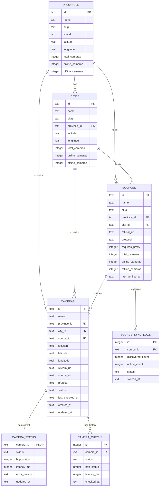

# Database Schema Specification

**Project:** PANTAU NUSANTARA — Indonesia Public CCTV Aggregator  
**Author:** Developed by Ganesha Ladesta  
**Database Engine:** SQLite (`node:sqlite` / Cloudflare D1 / Turso LibSQL compatible) + Normalized JSON Seed Files (`/data/*.json`)  

---

## 1. Entity-Relationship Diagram



---

## 2. SQLite / D1 DDL Schema

```sql
-- 1. Provinces (All 38 Indonesian Provinces)
CREATE TABLE IF NOT EXISTS provinces (
    id TEXT PRIMARY KEY,
    name TEXT NOT NULL,
    slug TEXT NOT NULL UNIQUE,
    island TEXT NOT NULL,
    latitude REAL NOT NULL,
    longitude REAL NOT NULL,
    total_cameras INTEGER NOT NULL DEFAULT 0,
    online_cameras INTEGER NOT NULL DEFAULT 0,
    offline_cameras INTEGER NOT NULL DEFAULT 0,
    city_count INTEGER NOT NULL DEFAULT 0,
    source_count INTEGER NOT NULL DEFAULT 0
);

-- 2. Cities & Regencies (Kota / Kabupaten)
CREATE TABLE IF NOT EXISTS cities (
    id TEXT PRIMARY KEY,
    name TEXT NOT NULL,
    slug TEXT NOT NULL,
    province_id TEXT NOT NULL REFERENCES provinces(id),
    province_name TEXT NOT NULL,
    latitude REAL NOT NULL,
    longitude REAL NOT NULL,
    total_cameras INTEGER NOT NULL DEFAULT 0,
    online_cameras INTEGER NOT NULL DEFAULT 0,
    offline_cameras INTEGER NOT NULL DEFAULT 0
);
CREATE INDEX IF NOT EXISTS idx_cities_province ON cities(province_id);

-- 3. CCTV Source Agencies (Dishub, Diskominfo, Bina Marga, etc.)
CREATE TABLE IF NOT EXISTS sources (
    id TEXT PRIMARY KEY,
    name TEXT NOT NULL,
    slug TEXT NOT NULL,
    province_id TEXT NOT NULL REFERENCES provinces(id),
    province_name TEXT NOT NULL,
    city_id TEXT NOT NULL REFERENCES cities(id),
    city_name TEXT NOT NULL,
    official_url TEXT NOT NULL,
    protocol TEXT NOT NULL,
    requires_proxy INTEGER NOT NULL DEFAULT 0,
    total_cameras INTEGER NOT NULL DEFAULT 0,
    online_cameras INTEGER NOT NULL DEFAULT 0,
    offline_cameras INTEGER NOT NULL DEFAULT 0,
    last_verified_at TEXT NOT NULL
);
CREATE INDEX IF NOT EXISTS idx_sources_province ON sources(province_id);

-- 4. Cameras (23,355+ Public CCTV Feeds)
CREATE TABLE IF NOT EXISTS cameras (
    id TEXT PRIMARY KEY,
    name TEXT NOT NULL,
    province_id TEXT NOT NULL REFERENCES provinces(id),
    province_name TEXT NOT NULL,
    city_id TEXT NOT NULL REFERENCES cities(id),
    city_name TEXT NOT NULL,
    source_id TEXT NOT NULL REFERENCES sources(id),
    source_name TEXT NOT NULL,
    location TEXT NOT NULL,
    latitude REAL NOT NULL,
    longitude REAL NOT NULL,
    stream_url TEXT NOT NULL,
    source_url TEXT NOT NULL,
    protocol TEXT NOT NULL CHECK (protocol IN ('HLS', 'MJPEG', 'SNAPSHOT', 'WEBSOCKET', 'MP4', 'EMBED')),
    status TEXT NOT NULL CHECK (status IN ('ONLINE', 'OFFLINE')),
    last_checked_at TEXT NOT NULL,
    created_at TEXT NOT NULL,
    updated_at TEXT NOT NULL
);
CREATE INDEX IF NOT EXISTS idx_cameras_province ON cameras(province_id);
CREATE INDEX IF NOT EXISTS idx_cameras_city ON cameras(city_id);
CREATE INDEX IF NOT EXISTS idx_cameras_source ON cameras(source_id);
CREATE INDEX IF NOT EXISTS idx_cameras_status ON cameras(status);
CREATE INDEX IF NOT EXISTS idx_cameras_protocol ON cameras(protocol);
CREATE INDEX IF NOT EXISTS idx_cameras_coords ON cameras(latitude, longitude);

-- 5. Real-Time Camera Status Overrides (Crowdsourced & Probe Updates)
CREATE TABLE IF NOT EXISTS camera_status (
    camera_id TEXT PRIMARY KEY REFERENCES cameras(id),
    status TEXT NOT NULL CHECK (status IN ('ONLINE', 'OFFLINE')),
    http_status INTEGER,
    latency_ms INTEGER,
    error_reason TEXT,
    updated_at TEXT NOT NULL
);

-- 6. Camera Health Check History
CREATE TABLE IF NOT EXISTS camera_checks (
    id INTEGER PRIMARY KEY AUTOINCREMENT,
    camera_id TEXT NOT NULL REFERENCES cameras(id),
    status TEXT NOT NULL,
    http_status INTEGER,
    latency_ms INTEGER,
    checked_at TEXT NOT NULL
);
CREATE INDEX IF NOT EXISTS idx_camera_checks_cam ON camera_checks(camera_id);

-- 7. Provider Adapter Sync Logs
CREATE TABLE IF NOT EXISTS source_sync_logs (
    id INTEGER PRIMARY KEY AUTOINCREMENT,
    source_id TEXT NOT NULL REFERENCES sources(id),
    discovered_count INTEGER NOT NULL,
    online_count INTEGER NOT NULL,
    status TEXT NOT NULL,
    synced_at TEXT NOT NULL
);
```

---

## 3. Canonical Camera JSON Record Format

Every item in `/data/cameras.json` and `GET /api/cameras` adheres to this normalized structure:

```json
{
  "id": "bandung-alun-alun-01",
  "name": "CCTV Alun-Alun 01 (Banceuy)",
  "province_id": "prov-jabar",
  "province_name": "Jawa Barat",
  "city_id": "city-jawa-barat-bandung",
  "city_name": "Bandung",
  "source_id": "src-pelindung-diskominfo-kota-bandung",
  "source_name": "PELINDUNG Diskominfo Kota Bandung",
  "location": "Bandung",
  "latitude": -6.921062,
  "longitude": 107.606394,
  "stream_url": "https://pelindung.bandung.go.id:3443/video/DAHUA/DepanTo.m3u8",
  "source_url": "https://pelindung.bandung.go.id",
  "protocol": "HLS",
  "status": "ONLINE",
  "last_checked_at": "2026-11-10T09:30:00.000Z",
  "created_at": "2026-11-10T09:30:00.000Z",
  "updated_at": "2026-11-10T09:30:00.000Z"
}
```

