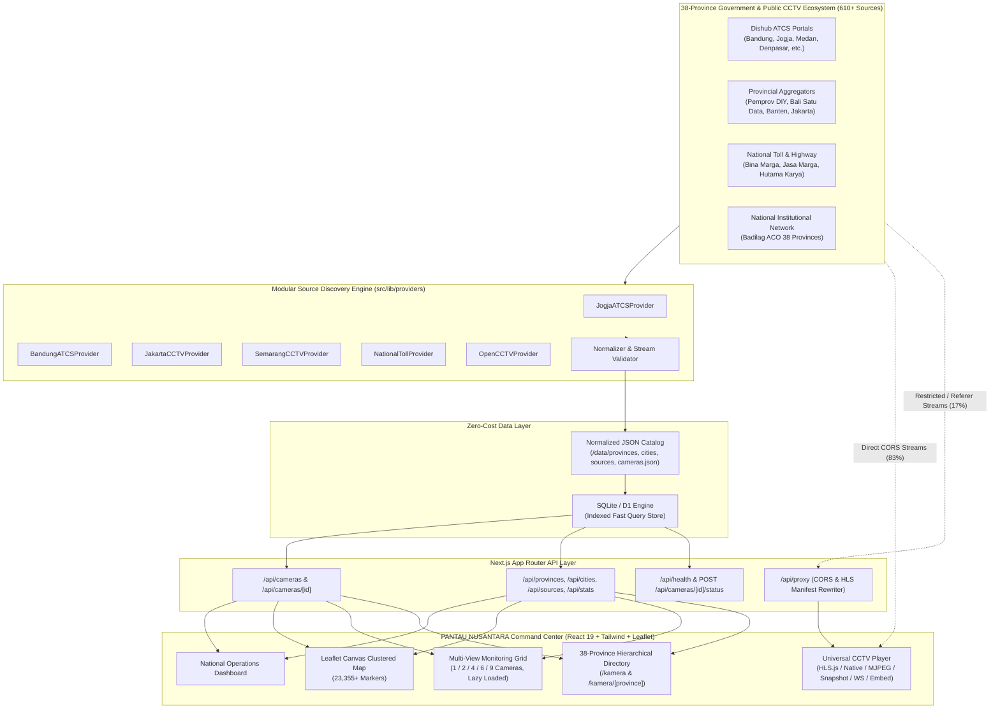

# System Architecture — PANTAU NUSANTARA

**Project:** PANTAU NUSANTARA — Indonesia Public CCTV Aggregator  
**Author:** Developed by Ganesha Ladesta  

---

## 1. High-Level Architecture Diagram

---

## 2. Core Subsystems

### 2.1 Modular Source Discovery Engine (`src/lib/providers/`)
Every CCTV source agency is integrated through a standardized TypeScript `CCTVProviderAdapter` interface:
- `getRegions()`: Returns the provinces and cities/regencies covered by the provider.
- `getCameras()`: Fetches raw camera listings from the upstream portal or API.
- `getCameraDetails(id)`: Retrieves stream URL and metadata for a specific camera.
- `normalizeCameraData(raw)`: Transforms provider-specific fields into the canonical `Camera` schema.
- `validateStream(url)`: Verifies HTTP status, CORS headers, and HLS/MJPEG playability.
- `getLastUpdated()`: Returns the last synchronization timestamp.

Included concrete adapters:
1. `JogjaATCSProvider` (`https://cctv.jogjakota.go.id/home/getdata` & `https://cctv.jogjaprov.go.id`)
2. `BandungATCSProvider` (`https://atcs-dishub.bandung.go.id/ajax/lokasi` & `https://pelindung.bandung.go.id`)
3. `JakartaCCTVProvider` (`https://dki-jkt.balitower.co.id` & Jakarta Smart City)
4. `SemarangCCTVProvider` (`Pantau Semar` / Semarang ATCS)
5. `NationalTollProvider` (`Bina Marga`, `Jasa Marga jmlive`, `Hutama Karya Trans-Sumatera`)
6. `OpenCCTVProvider` (`OpenCCTV` / National Public Registry across all 38 provinces)

### 2.2 Fast In-Memory + SQLite Indexed Store (`src/lib/data-store.ts`)
- Loads `/data/provinces.json` (38 provinces), `/data/cities.json` (557 cities), `/data/sources.json` (610 sources), and `/data/cameras.json` (23,355 cameras) into an indexed singleton store and synchronizes with SQLite (`node:sqlite`) when needed.
- Supports compact marker serialization (`mode=markers`) so the browser can load all 23,355 map coordinates in ~1.2 MB and render them at 60 FPS on an HTML5 `<canvas>` layer.

### 2.3 Universal CCTV Player (`src/components/cctv-player.tsx`)
- Automatically detects protocol (`HLS`, `MJPEG`, `SNAPSHOT`, `WEBSOCKET`, `MP4`, `EMBED`).
- For `HLS` (`.m3u8`), initializes `hls.js` with low-latency tuning and automatic fallback to `/api/proxy` if a direct request encounters a browser CORS or mixed-content error!
- Includes a 25-second watchdog timer, automatic retry with exponential backoff, snapshot capture, fullscreen toggle, live latency badge, and official source attribution link.

### 2.4 Multi-View Operations Wall (`src/components/multi-view-grid.tsx`)
- Supports **1, 2, 4, 6, and 9 simultaneous cameras** with **zero paywalls and zero watch-time limits**.
- Uses `IntersectionObserver` so off-screen camera cells pause decoding and release MediaSource buffers when scrolled out of view.
- Persists active multi-view selections in both URL parameters (`?multi=id1,id2,...`) and `localStorage` (`pantau_nusantara_multiview`), plus includes curated regional presets (e.g., *Pantau Tol Trans-Jawa*, *Pantau Kota Bandung*, *Pantau Malioboro & DIY*, *Pantau DKI Jakarta*, *Pantau Lintas Sumatera*).

